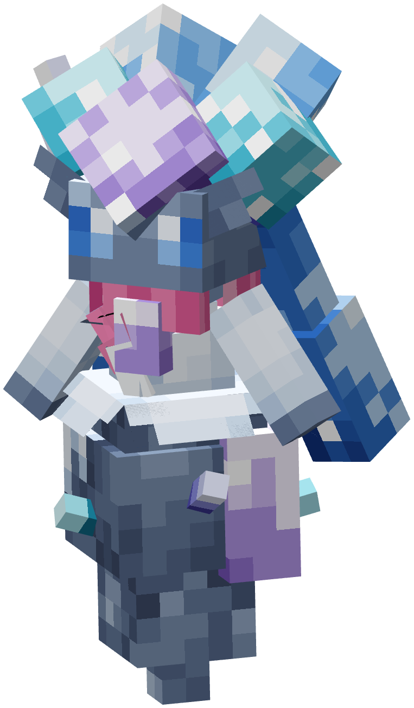
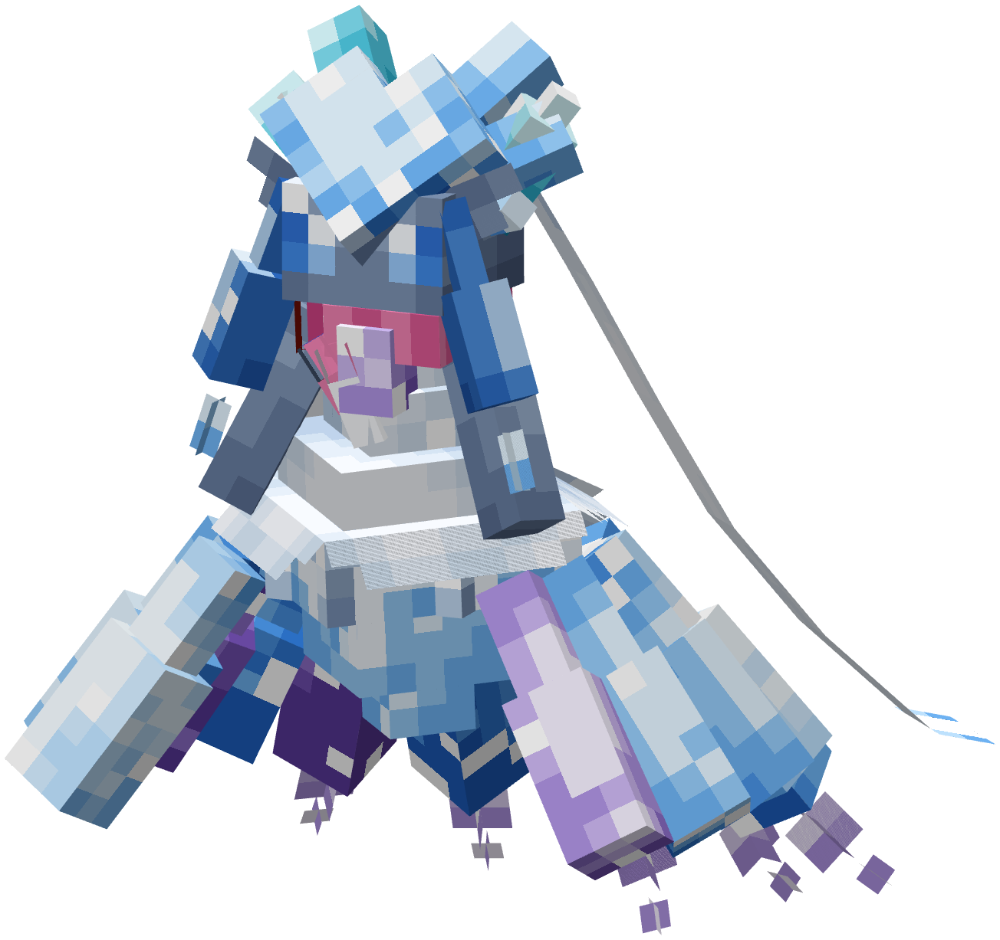
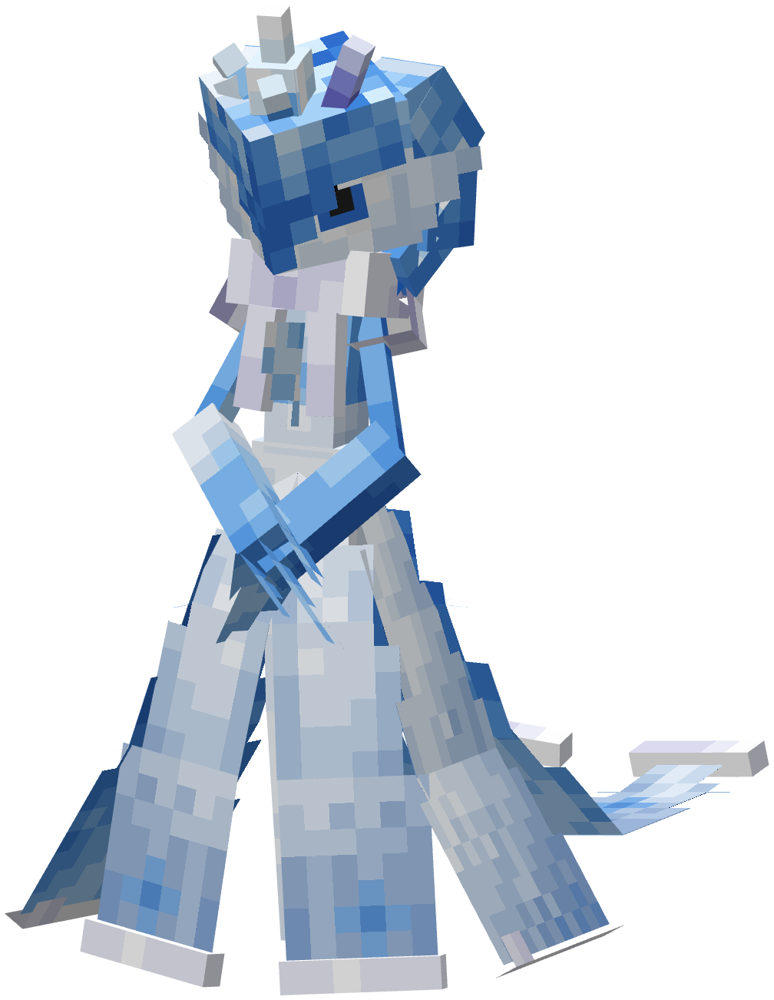
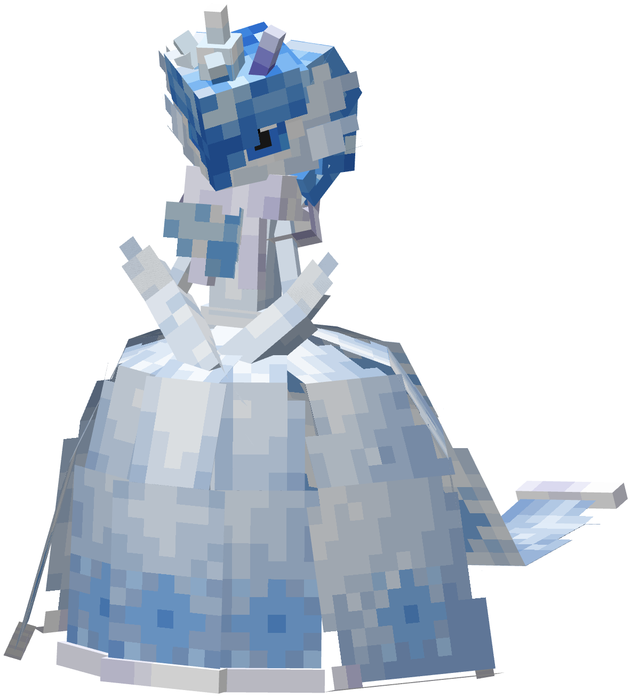
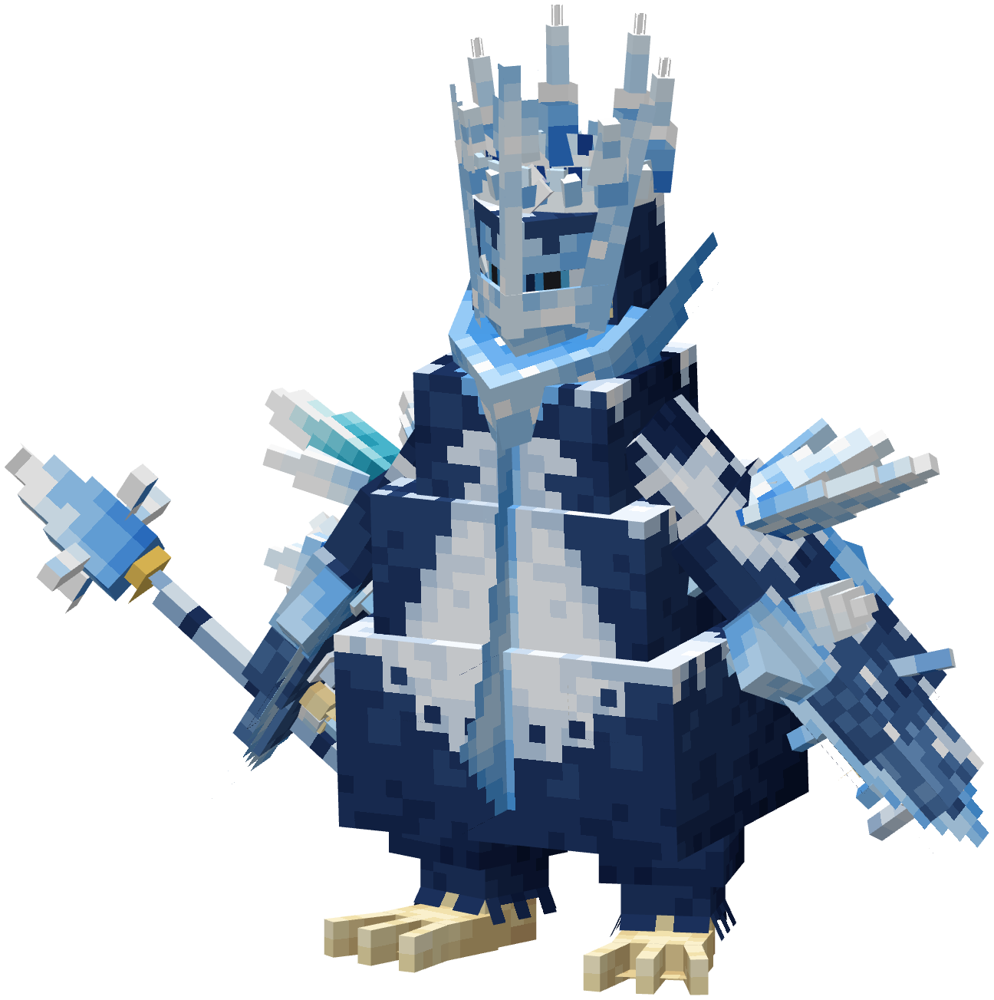
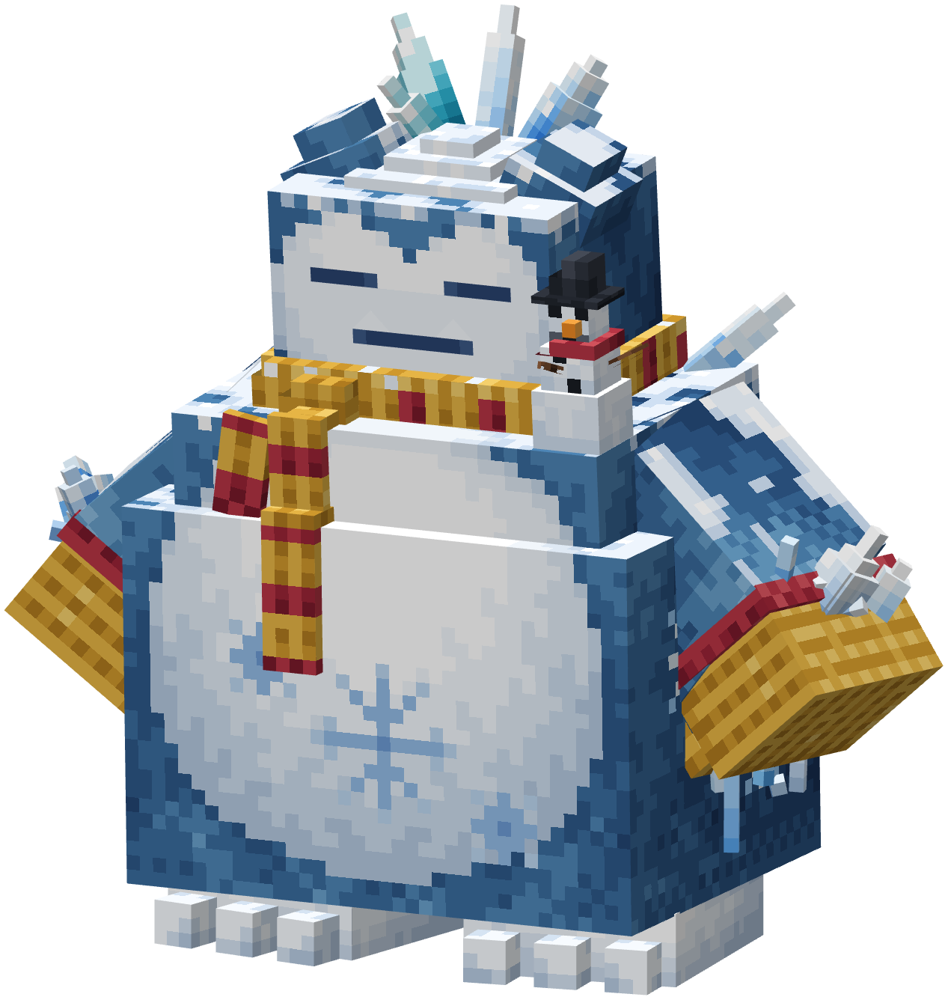
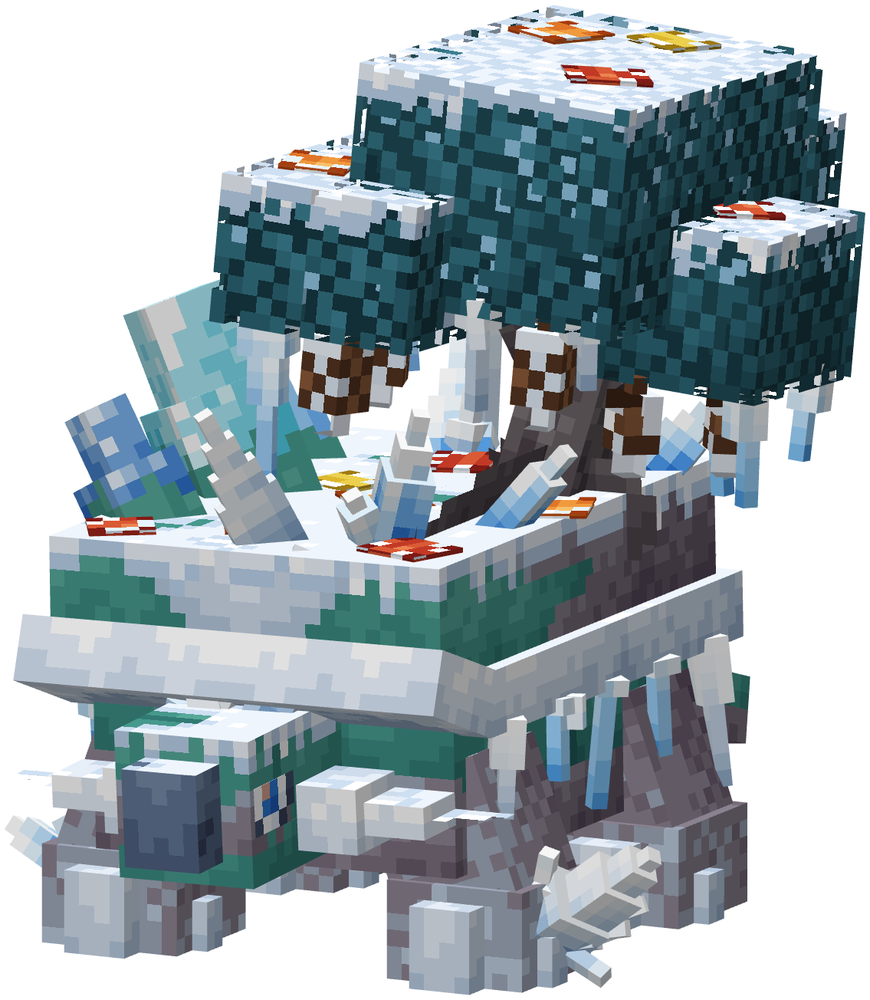
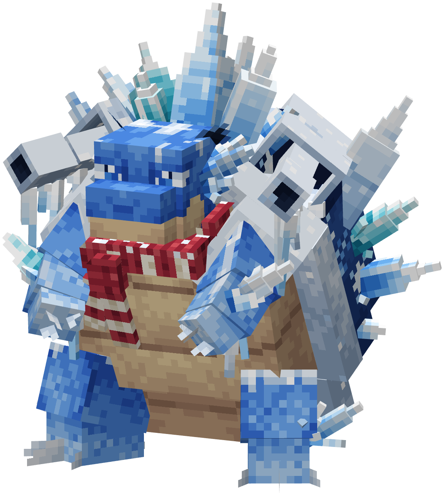
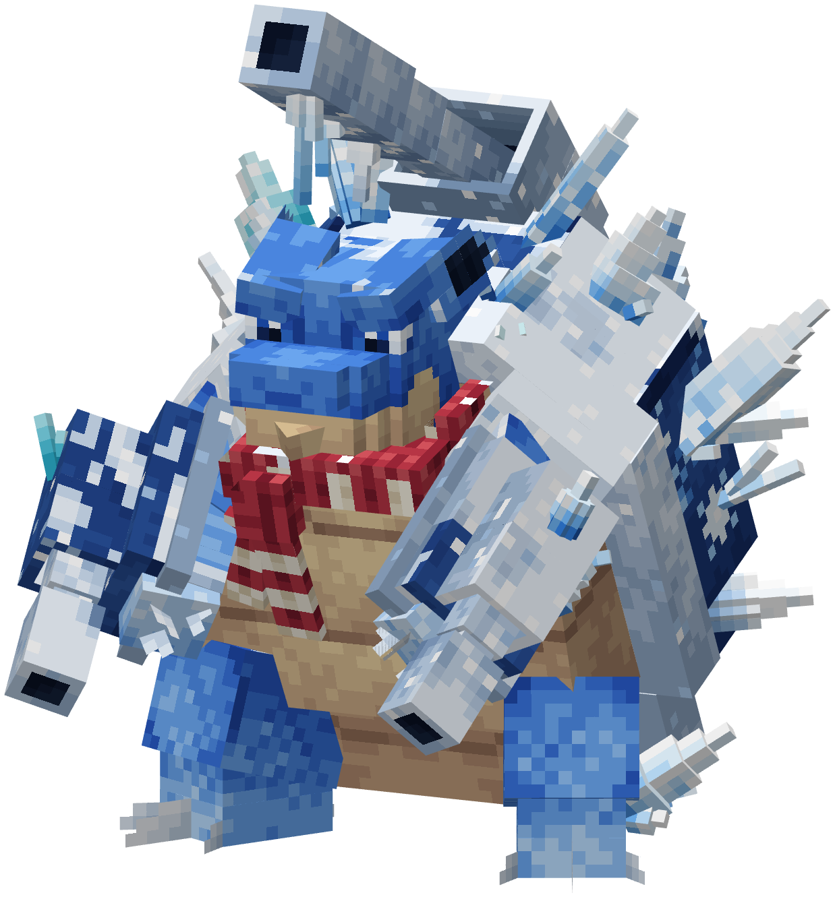

# Pokémon Novembre 2026

Les Pokémon Novembre sont des **formes cosmétiques** : ils gardent les types, les statistiques et les talents de leur forme normale. Leurs bébés naissent sans l'apparence Novembre.

## Comment les obtenir

* **[Pass de combat](../../pokeisland/battle-pass.md)** de novembre : six Pokémon Novembre sont sur la voie **premium**, aux niveaux 1, 5, 13, 20, 27 et 37.

Le pass est remis à zéro le 1er du mois : ces Pokémon ne s'obtiennent qu'en novembre.

Les formes Méga apparaissent en combat, quand un Pokémon Novembre méga-évolue avec sa Méga-Gemme (voir [Mega Showdown](../mega-showdown.md)). En Gigamax, Tortank et Ronflex Novembre reprennent l'apparence Gigamax normale.

Diancie Novembre

<figure><figcaption></figcaption></figure>

**Obtention :** Pass de combat, niveau 37 (premium). Pokémon fabuleux.

**Méga-Diancie Novembre** : en combat, en tenant la Diancite.

<figure><figcaption></figcaption></figure>

Gardevoir Novembre

<figure><figcaption></figcaption></figure>

**Obtention :** Pass de combat, niveau 20 (premium).

**Méga-Gardevoir Novembre** : en combat, en tenant la Gardevoirite.

<figure><figcaption></figcaption></figure>

Pingoléon Novembre

<figure><figcaption></figcaption></figure>

**Obtention :** Pass de combat, niveau 27 (premium).

Ronflex Novembre

<figure><figcaption></figcaption></figure>

**Obtention :** Pass de combat, niveau 13 (premium).

Torterra Novembre

<figure><figcaption></figcaption></figure>

**Obtention :** Pass de combat, niveau 5 (premium).

Tortank Novembre

<figure><figcaption></figcaption></figure>

**Obtention :** Pass de combat, niveau 1 (premium).

**Méga-Tortank Novembre** : en combat, en tenant la Tortankite.

<figure><figcaption></figcaption></figure>

