# Pêche

La **pêche** est un métier : chaque prise te donne de l'**XP de pêche**, un **poisson de collection** et parfois un **trésor**. Tout se gère depuis `/peche`, et ta progression te suit sur tous les serveurs.

<div align="left"><figure>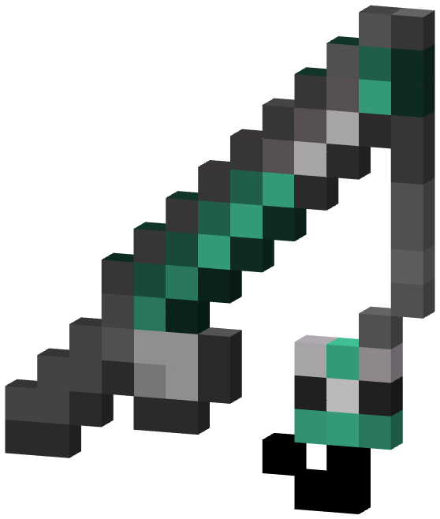<figcaption><p>La Canne du Léviathan, la plus puissante du jeu</p></figcaption></figure></div>

***

## La boucle en 4 étapes

1. **Pêche** avec une Poké Canne et réussis le **mini-jeu** quand ça mord.
2. Ta prise remonte : un **Pokémon** (environ 1 fois sur 7) ou un **objet de pêche** Cobblemon, **plus** un **poisson de collection**.
3. Chez l'**Archiviste** (`/peche`), **dépose** les nouvelles espèces au carnet et **vends** les doublons contre des **Écailles**.
4. Avec les Écailles, achète des **améliorations** pour fabriquer des **cannes** plus puissantes.

***

## Pêcher

Quand ça mord, réussis **3 étapes en 15 secondes**. Le jeu choisit une variante à chaque touche :

| Variante | Quand cliquer |
| -------- | ------------- |
| **Ferrage précis** | Le curseur entre dans la zone encadrée |
| **Anneau de remous** | L'anneau mobile rejoint l'anneau cible |
| **Poisson en mouvement** | L'hameçon est aligné sur le poisson |
| **Réflexe gauche/droite** | Clic du **côté demandé** |


Un clic raté, **Échap**, la mort, une déconnexion ou les 15 secondes écoulées font **fuir la prise**.


**Zones de pêche :** sur les **îles du Spawn**, l'**eau teintée en bleu** marque une zone de pêche (`/peche zones`). Ailleurs, tu pêches à taux réduits : un poisson de collection sur trois environ, XP ×0,5 et trésors ×0,35.

***

## Les 48 poissons

À chaque prise, le jeu tire une **rareté**, puis un poisson de cette rareté. Chaque poisson a un **poids** : ton record par espèce est gardé, et le plus lourd du réseau s'affiche dans `/peche top`.

| Rareté | Chance (de base) | Prix de vente |
| ------ | ---------------: | ------------: |
| Commun | 78 % | 10 Écailles |
| Peu commun | 18 % | 25 Écailles |
| Rare | 3,5 % | 75 Écailles |
| Épique | 0,45 % | 250 Écailles |
| **Légendaire** | 0,049 % | 1 000 Écailles |
| **Mythique** | 0,049 % | 5 000 Écailles |

* **Poisson mystère** (15 % des poissons) : l'Archiviste l'**analyse** pour révéler l'espèce.
* Les légendaires et mythiques inscrits au carnet sont **annoncés sur tout le réseau**.
* **Carnet complet** (48 espèces) : un **Chiyu de pêche** offert.
* Inventaire plein ? Tout t'attend dans `/mailbox`.

<details>

<summary>Voir les 48 poissons</summary>

**Commun**

| | Poisson | Poids |
| :-: | ------- | ----: |
| 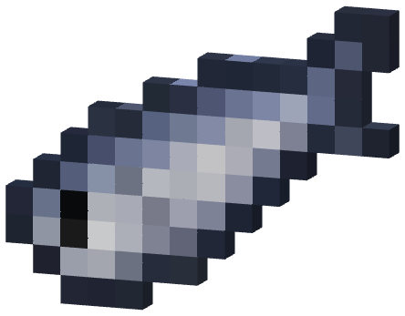 | Sardine argentée | 0,1 à 0,4 kg |
| 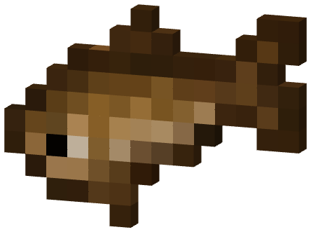 | Goujon des rivières | 0,1 à 0,5 kg |
| 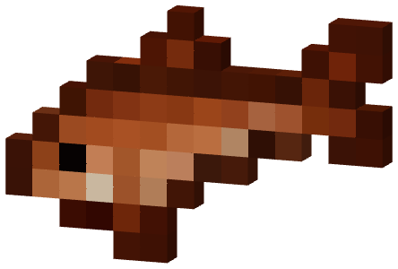 | Gardon cuivré | 0,2 à 1,2 kg |
| 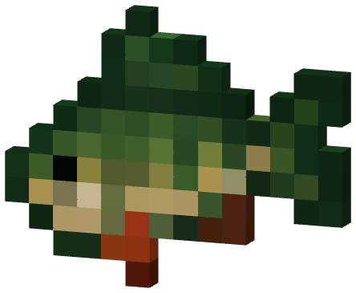 | Perche rayée | 0,3 à 2,0 kg |
| 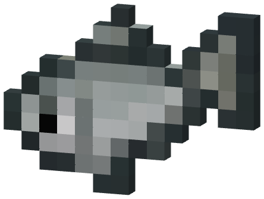 | Ablette nacrée | 0,1 à 0,3 kg |
| 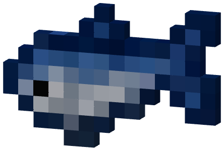 | Maquereau bleu | 0,3 à 1,5 kg |
| 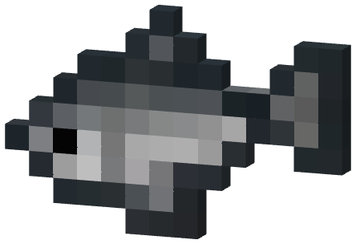 | Sprat des quais | 0,1 à 0,3 kg |
| 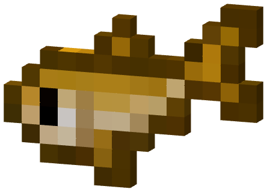 | Vairon doré | 0,1 à 0,4 kg |

**Peu commun**

| | Poisson | Poids |
| :-: | ------- | ----: |
| 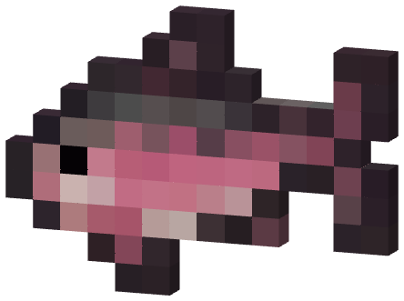 | Truite rosée | 0,5 à 4,0 kg |
| 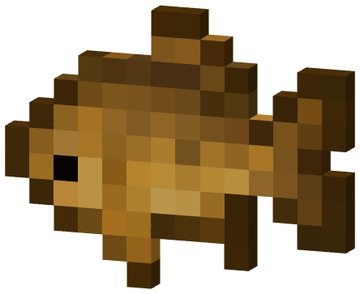 | Carpe ambrée | 1,0 à 12,0 kg |
| 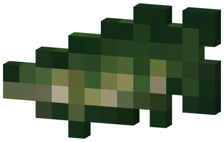 | Brochet émeraude | 1,0 à 10,0 kg |
| 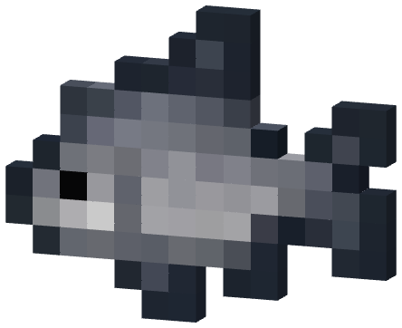 | Brème lunaire | 0,5 à 5,0 kg |
| 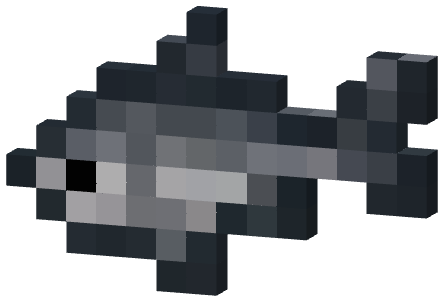 | Mulet des marées | 0,5 à 4,0 kg |
| 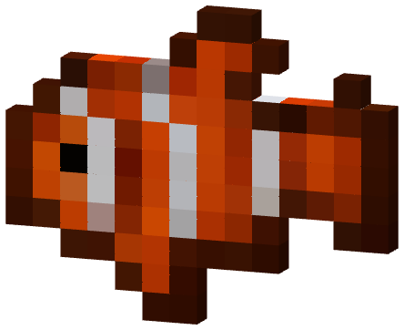 | Poisson-clown corail | 0,1 à 0,8 kg |
| 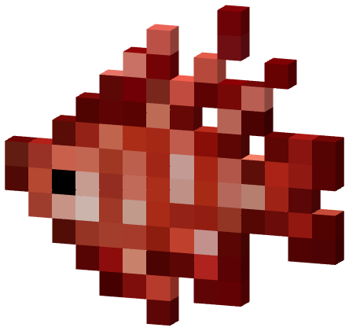 | Rascasse flamboyante | 0,2 à 2,0 kg |
| 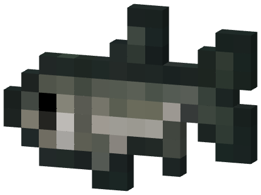 | Bar des embruns | 1,0 à 7,0 kg |

**Rare**

| | Poisson | Poids |
| :-: | ------- | ----: |
| 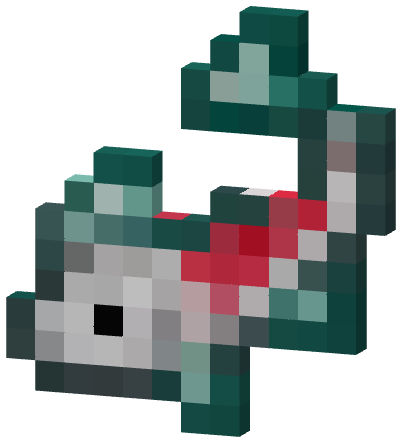 | Koï de jade | 1,0 à 8,0 kg |
| 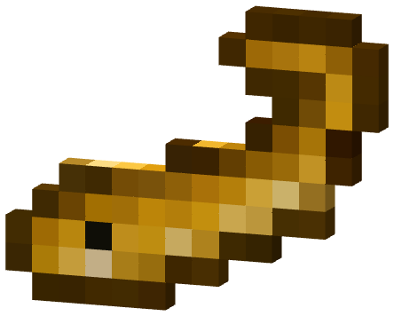 | Anguille électrique | 1,0 à 6,0 kg |
| 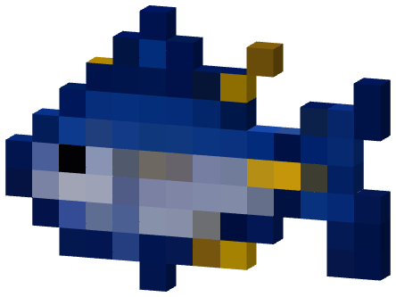 | Thon azur | 5,0 à 80,0 kg |
| 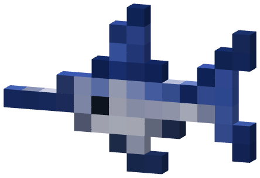 | Espadon argenté | 10,0 à 100,0 kg |
| 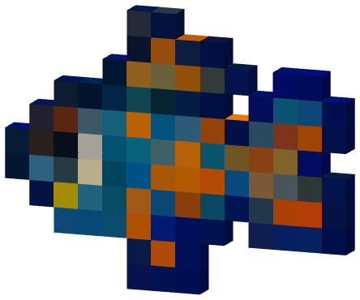 | Mandarin arc-en-ciel | 0,1 à 0,8 kg |
| 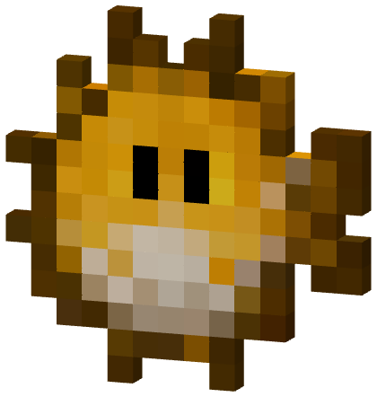 | Globe à étoiles | 0,2 à 2,0 kg |
| 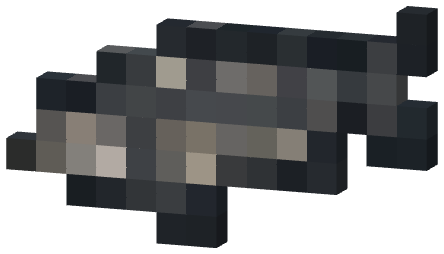 | Esturgeon ancien | 5,0 à 60,0 kg |
| 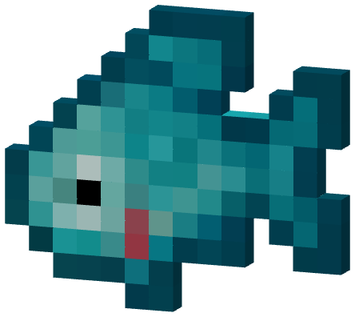 | Perroquet turquoise | 0,5 à 5,0 kg |

**Épique**

| | Poisson | Poids |
| :-: | ------- | ----: |
| 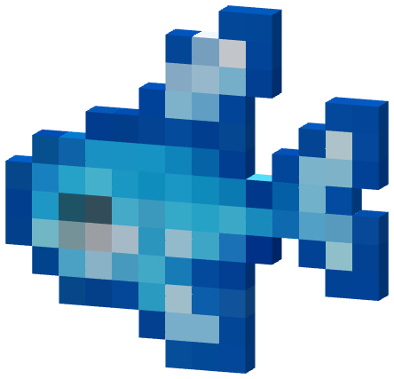 | Truite de cristal | 1,0 à 10,0 kg |
| 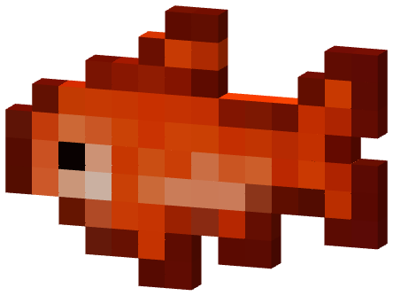 | Carpe des braises | 2,0 à 20,0 kg |
| 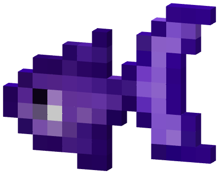 | Nage-lune | 0,5 à 6,0 kg |
| 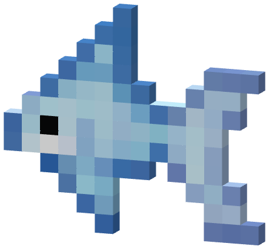 | Poisson fantôme | 0,5 à 8,0 kg |
| 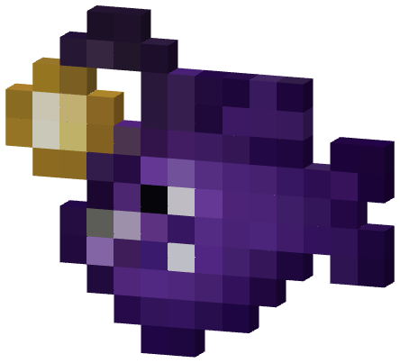 | Baudroie abyssale | 2,0 à 25,0 kg |
| 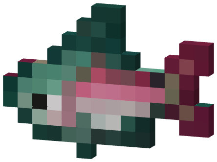 | Saumon boréal | 2,0 à 15,0 kg |
| 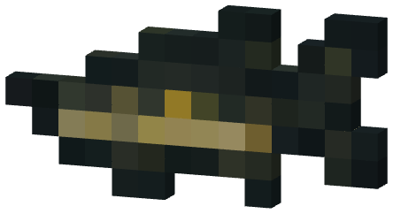 | Brochet d'obsidienne | 3,0 à 25,0 kg |
| 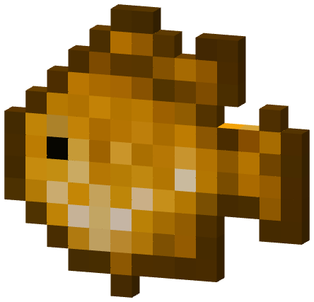 | Écaille solaire | 1,0 à 10,0 kg |

**Légendaire**

| | Poisson | Poids |
| :-: | ------- | ----: |
| 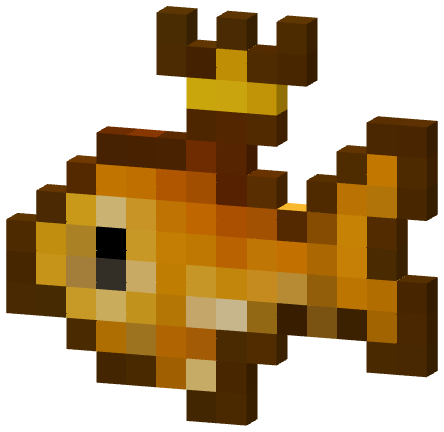 | Carpe couronnée | 10,0 à 60,0 kg |
| 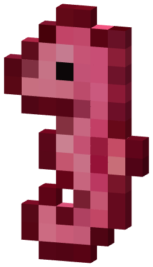 | Dragon des récifs | 5,0 à 40,0 kg |
| 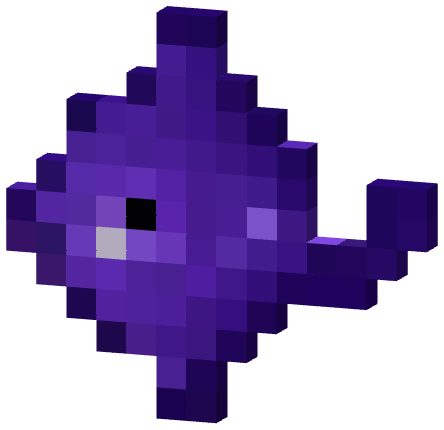 | Raie du néant | 15,0 à 100,0 kg |
| 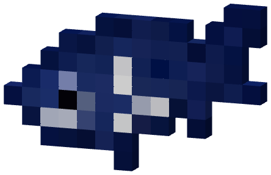 | Esturgeon stellaire | 20,0 à 150,0 kg |
| 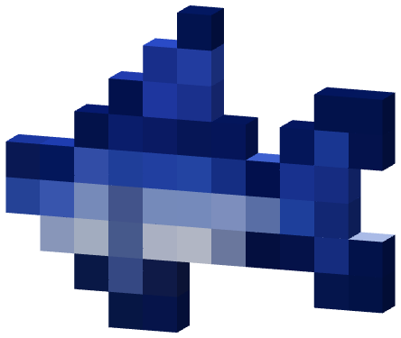 | Espadon des tempêtes | 25,0 à 160,0 kg |
| 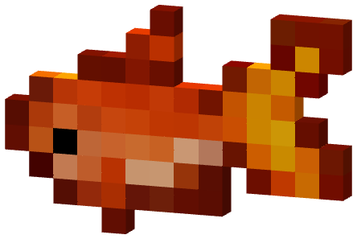 | Saumon phénix | 10,0 à 70,0 kg |
| 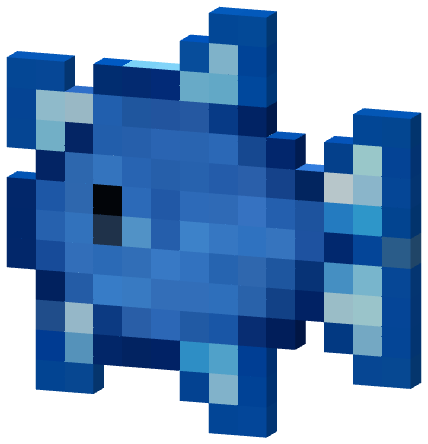 | Globe saphir | 2,0 à 12,0 kg |
| 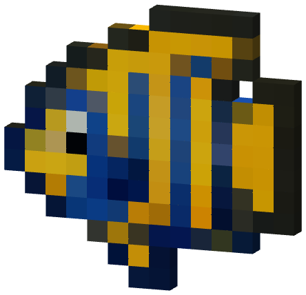 | Empereur des mers | 20,0 à 120,0 kg |

**Mythique**

| | Poisson | Poids |
| :-: | ------- | ----: |
| 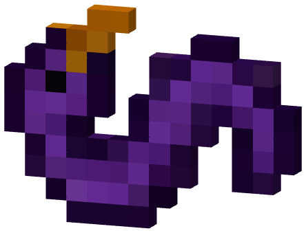 | Petit Léviathan | 50,0 à 300,0 kg |
| 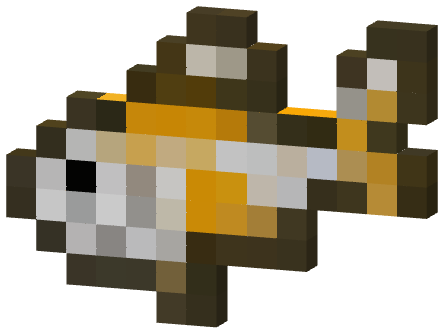 | Koï éternelle | 10,0 à 80,0 kg |
| 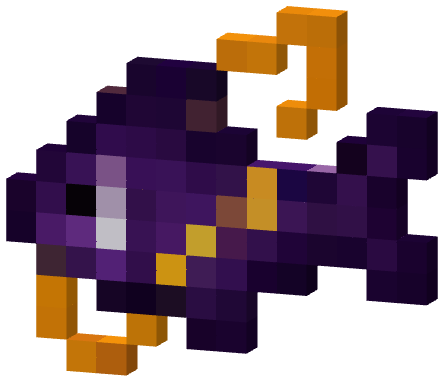 | Poisson cosmique | 5,0 à 60,0 kg |
| 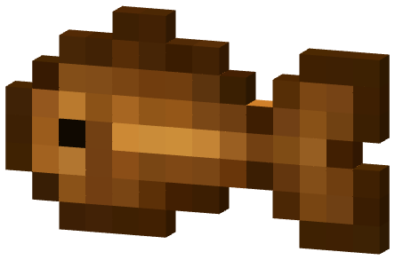 | Gardien du temps | 30,0 à 200,0 kg |
| 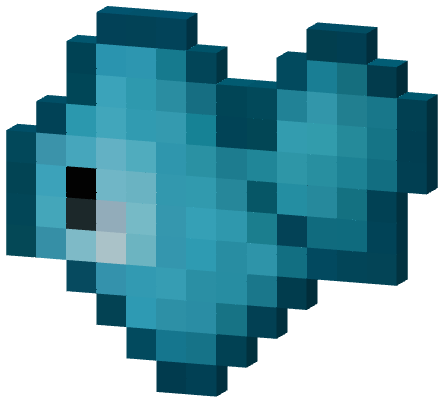 | Cœur de l'océan | 20,0 à 150,0 kg |
| 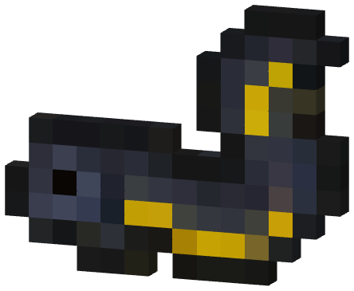 | Anguille éclipse | 15,0 à 100,0 kg |
| 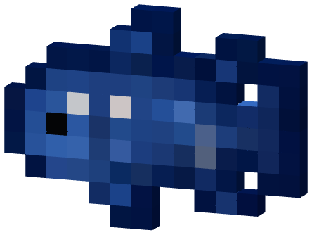 | Ancêtre des marées | 80,0 à 400,0 kg |
| 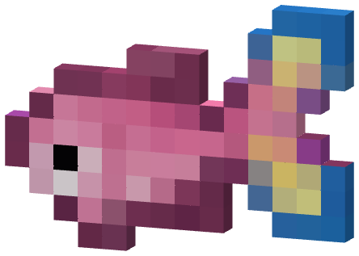 | Poisson des souhaits | 1,0 à 20,0 kg |

</details>

***

## Écailles et boutique

Les **Écailles** se gagnent en vendant tes doublons, en montant de niveau et sur le podium des tournois. Elles s'utilisent dans la **boutique de l'Archiviste**, seul endroit où acheter les améliorations de canne :

| | Amélioration | Prix | Niveau requis |
| :-: | ------------ | ---: | :-----------: |
| 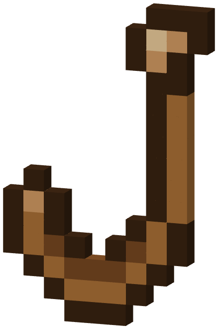 | Hameçon renforcé | 150 | 1 |
|  | Ligne tressée | 400 | 8 |
|  | Moulinet des marées | 900 | 15 |
|  | Moulinet d'argent | 1 800 | 22 |
|  | Noyau de tempête | 3 500 | 28 |
|  | Cœur d'étoile | 7 000 | 40 |
|  | Étoile du Nether | 50 000 | 1 |

***

## Les cannes

Chaque canne se fabrique à l'**établi** : la **canne précédente** au centre, **deux améliorations** de son palier de chaque côté et quelques matériaux (perles marines, fragments des abysses…). Le détail est dans ton livre de recettes.

```
Poké Canne
└─ Canne vive ─┬─ Canne exploratrice ─┬─ Canne des marées ─ Canne du grand large
               │                      └─ Canne abyssale ─── Canne lunaire
               ├─ Canne corallienne ─── Canne du savant ─── Canne astrale
               └─ Canne aux trésors ─── Canne des tempêtes ─ Canne du Léviathan
```

| | Canne | Niveau | XP | Meilleurs poissons | Trésors | Shiny |
| :-: | ----- | :----: | :-: | :----------------: | :-----: | :---: |
|  | Canne vive | 1 | ×1,25 | ×1,0 | ×1,0 | +3 % |
|  | Canne exploratrice | 5 | ×1,0 | ×1,2 | ×1,0 | +5 % |
|  | Canne corallienne | 8 | ×1,5 | ×1,1 | ×1,0 | +5 % |
|  | Canne aux trésors | 10 | ×1,0 | ×1,0 | ×2,0 | +6 % |
|  | Canne des marées | 15 | ×1,2 | ×1,4 | ×1,2 | +6 % |
|  | Canne abyssale | 20 | ×1,1 | ×1,1 | ×1,5 | +8 % |
|  | Canne du savant | 22 | ×2,0 | ×1,0 | ×1,2 | +8 % |
|  | Canne du grand large | 25 | ×1,1 | ×1,7 | ×1,0 | +9 % |
|  | Canne des tempêtes | 28 | ×1,2 | ×1,2 | ×3,0 | +11 % |
|  | Canne lunaire | 32 | ×1,6 | ×1,3 | ×2,0 | +12 % |
|  | Canne astrale | 40 | ×2,3 | ×1,3 | ×2,5 | +15 % |
|  | **Canne du Léviathan** | 45 | ×2,0 | ×1,8 | ×3,5 | +18 % |

Le **niveau** est celui requis pour **utiliser** la canne. « Meilleurs poissons » multiplie les chances des raretés Rare et au-dessus, « Shiny » la chance que le Pokémon pêché soit shiny. Chaque branche a sa spécialité : l'**XP** (corallienne → astrale), les **trésors** (aux trésors → Léviathan) ou les **meilleurs poissons** (exploratrice → grand large).

### Les appâts

| | Appât (×4) | Recette sans forme | Effet |
| :-: | ---------- | ------------------ | ----- |
|  | Appât des marées | Blé + Algue | Touche plus rapide |
|  | **Appât raffiné** | Blé + Carotte dorée | Pokémon rares, et meilleurs poissons ×1,5 |
|  | Appât des profondeurs | Blé + Poche d'encre | Pokémon aquatiques des profondeurs |

***

## Les bonus et leur cumul

Les bonus se **multiplient** entre eux (meilleurs poissons plafonnés à ×10) :

| Bonus | Canne | Appât raffiné | Zone bonus | Banc | Hors zone |
| ----- | :---: | :-----------: | :--------: | :--: | :-------: |
| XP | ✔ | | ×1,5 | ×2 | ×0,5 |
| Meilleurs poissons | ✔ | ×1,5 | ×2 | | |
| Trésors | ✔ | | ×1,5 | | ×0,35 |

* **Zone bonus** : une zone de pêche est renforcée, et le bonus change de zone **toutes les 15 minutes**. Son eau devient **dorée** (`/peche bonus`).
* **Banc de poissons** : toutes les 15 minutes, des remous apparaissent dans une zone (coordonnées dans le chat). L'XP y est doublée pendant 5 minutes, dans un rayon de 8 blocs.

***

## Niveaux et récompenses

Chaque prise donne **10 XP** (avant bonus). Il faut 100 XP de plus à chaque niveau, soit **122 500 XP** pour atteindre le **niveau 50**. Chaque niveau rapporte **2 Bonbons Exp. M** et **20 Écailles × le niveau atteint**, plus :

| Niveau | Récompense | Niveau | Récompense |
| :----: | ---------- | :----: | ---------- |
| 5 | 3 Super Bonbons, 1 CT | 30 | 2 Cristaux IV Parfaits, +1 000 Écailles |
| 10 | Cristal IV Parfait, +500 Écailles | 35 | Œuf Céleste |
| 15 | 10 Appâts raffinés | 40 | Master Ball |
| 20 | Méga Gemme | 45 | Œuf Légendaire |
| 25 | Œuf Shiny | **50** | **Chiyu de pêche shiny** |

***

## Activités

* **Contrat du jour** : 15 prises, puis `/peche contrats valider` pour **75 XP** et une **perle marine**. Renouvelé à minuit.
* **Tournois** : classement au poids, au nombre de prises ou au nombre d'espèces (3 prises minimum). Podium : **1 500 / 800 / 400 Écailles**. Un tournoi se lance **chaque soir à 21h** (`/peche tournoi`).
* **Trésors** : à chaque prise, une chance de **fragment des abysses**  (3 %), de **perle marine**  (0,5 %) ou d'un autre trésor (2,5 %) : bonbons, CT, cristaux, améliorations de canne, œufs… et très rarement une **Master Ball**.
* **Le Léviathan des Abysses** : lors d'un événement, pêcher en zone donne des **lots d'écailles de Léviator** , à offrir à l'autel commun (`/peche communaute`). Une fois l'objectif atteint, le boss apparaît : tu le frappes en esquivant ses attaques. Il ne se capture pas.

***

## Commandes

| Commande | Effet |
| -------- | ----- |
| `/peche` | Menu principal (profil, Archiviste, carnet…) |
| `/peche carnet` | Ton carnet des 48 poissons |
| `/peche contrats` | Contrat du jour |
| `/peche zones` | Lieux de pêche |
| `/peche bonus` | Zone bonus active |
| `/peche tournoi` | Tournoi en cours |
| `/peche top` | Records de poids |
| `/peche aide` | Guide en jeu |
